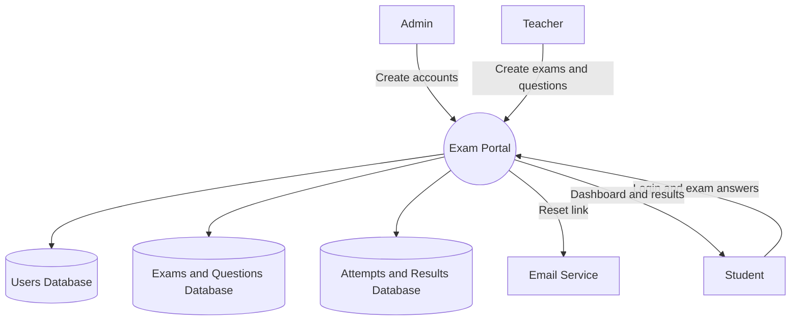
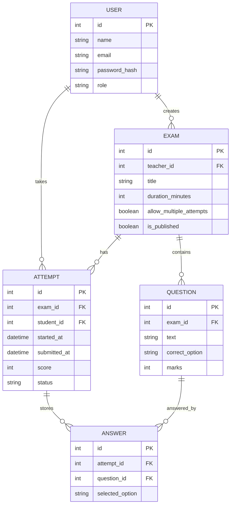

# Software Requirements Specification (SRS)
## Project: Online Exam Portal
**Version:** 1.0 · **Status:** Initial project specification

## 1. Introduction
### 1.1 Purpose of Project
The purpose is to develop a web-based examination portal that allows administrators to manage users, teachers to create and publish examinations, and students to take timed examinations and review their results.

### 1.2 Scope of Project
The system supports three roles: Admin, Teacher and Student. It includes account creation, authentication, password reset by email, exam and question management, timed attempts, configurable multiple attempts, automatic submission, and per-attempt result history. The initial release supports single-correct-answer multiple-choice questions.

### 1.3 Definitions & Overview
- **Admin:** Creates teacher and student accounts and oversees the portal.
- **Teacher:** Creates exams, adds questions, and publishes exams.
- **Student:** Takes published exams and views attempt history.
- **Attempt:** One student's individual sitting of an exam.
- **FR/NFR:** Functional / Non-functional requirement.

## 2. Research Problem
### 2.1 Problem Statement
Manual examination workflows require significant effort to distribute questions, track time, evaluate answers, and maintain student result records. They can also make it difficult to maintain consistent records across repeat attempts.

### 2.2 Existing System & Limitations
Paper-based or spreadsheet-based processes may require manual checking, are difficult to scale, can delay result publication, and often lack centralized access control, automatic timing, and attempt-wise history.

### 2.3 Need for New System
A centralized web application is needed to provide role-specific workflows, automatic MCQ evaluation, timed exams, configurable retakes, and secure, searchable digital records.

## 3. Research Flow
### 3.1 Data Flow Diagram

### 3.2 Step-by-Step Flow Explanation
1. Admin signs in and creates teacher/student accounts.
2. Teacher signs in, creates an exam, adds MCQ questions and publishes it.
3. Student signs in and sees published exams.
4. Student starts an exam; the server creates a unique attempt and records its start time.
5. Student selects answers and can save or submit them.
6. The portal evaluates answers, stores the score and submission time, and shows the result in history.
7. If retakes are enabled, a new attempt is created with its own result record.
8. A user who forgets a password requests a time-limited reset link by email.

## 4. Research Objectives
### 4.1 Main Objective
To design and implement a secure, role-based online examination portal that simplifies exam administration and result management.

### 4.2 Specific Objectives
- **O1:** Provide role-based login and administrator-managed account creation.
- **O2:** Allow teachers to create, manage and publish timed MCQ examinations.
- **O3:** Allow students to complete exams, receive automatic evaluation, and view separate results for each attempt.

## 5. Proposed Methodology
### 5.1 SDLC Model Used
An **Iterative model** is proposed. Core authentication and role management are implemented first, followed by exam authoring, student attempts, result history, and security testing. Feedback can be incorporated between iterations.

### 5.2 Tools & Technologies Used
- Front end: HTML5, CSS3, JavaScript, Jinja templates
- Back end: Python 3, Flask
- Database: PostgreSQL (SQLite for local development)
- Authentication: Flask-Login; password hashing through Werkzeug
- Forms/security: Flask-WTF CSRF protection
- Hosting: GitHub for source control; Render for web service and PostgreSQL
- Email: SMTP for password reset

### 5.3 System Architecture / DFD / ERD
The browser sends HTTPS requests to the Flask application. Flask validates the session, role and form data, applies business rules, and reads/writes PostgreSQL records. SMTP is used to deliver password-reset links.

### 5.4 Modules Description
1. **Authentication module:** Login, logout, password hashing and password reset.
2. **Admin module:** Create teacher/student accounts and view users/exams.
3. **Teacher module:** Create exams, add MCQs, publish/unpublish exams and toggle multiple attempts.
4. **Student module:** View published exams, start/resume exams and view attempt history.
5. **Examination module:** Track duration, save answers, submit and automatically evaluate.
6. **Result module:** Persist and display a distinct score for every submitted attempt.

## 6. Security Assessment Methods
### 6.1 Functional Requirements
- **FR-01:** The system shall authenticate users using email and password.
- **FR-02:** The system shall enforce Admin, Teacher and Student role permissions.
- **FR-03:** Admin shall be able to create Teacher and Student accounts.
- **FR-04:** Teacher shall be able to create exams and add MCQ questions.
- **FR-05:** Teacher shall be able to publish/unpublish an exam.
- **FR-06:** Teacher shall be able to enable or disable multiple attempts per exam.
- **FR-07:** Student shall be able to view published exams and start/resume an attempt.
- **FR-08:** The system shall enforce the exam duration and submit expired attempts on the next request.
- **FR-09:** The system shall evaluate submitted MCQ answers automatically.
- **FR-10:** The system shall store a separate result for every attempt.
- **FR-11:** Student shall be able to view personal attempt history and results.
- **FR-12:** The system shall send a time-limited password-reset link by email.

### 6.2 Non-Functional Requirements
- **NFR-01 Security:** Passwords shall be stored as salted password hashes, never plaintext.
- **NFR-02 Authorization:** Users shall only access resources permitted by their role and ownership.
- **NFR-03 Integrity:** Each attempt and its answers shall be stored as separate database records.
- **NFR-04 Usability:** The interface shall be responsive and usable on desktop and mobile browsers.
- **NFR-05 Maintainability:** The application shall use modular routes, models and templates.
- **NFR-06 Availability:** Deployment shall use a managed hosting service and database.
- **NFR-07 Performance:** Common dashboard requests should complete within an acceptable response time under the expected academic workload.
- **NFR-08 Recovery:** Production database backups should be configured by the deployment owner.

### 6.3 Security Testing
- **SQL Injection:** Submit SQL metacharacters in login and form fields; verify ORM parameterization and absence of unauthorized data access.
- **XSS:** Submit HTML/JavaScript payloads in names, descriptions and questions; verify output is escaped.
- **Authentication:** Test invalid credentials, session logout, reset-token expiry and password hashing.
- **Authorization:** Attempt cross-role access and access to another student's attempt or another teacher's exam.
- **CSRF:** Submit state-changing forms without valid CSRF tokens and verify rejection.
- **Exam integrity:** Test deadline enforcement, duplicate submissions, and multiple-attempt ON/OFF behavior.

### 6.4 Tools
OWASP ZAP, Burp Suite Community Edition, browser developer tools, and manual test scripts may be used. Test only systems for which permission has been granted.

## 7. Output and Observations
### 7.1 Screenshots of Output
Insert screenshots after deployment:
- Login page
- Admin dashboard and account creation
- Teacher exam/question management
- Student exam dashboard
- Timed exam page
- Result history and individual result

### 7.2 Test Cases & Results Table
| ID | Test scenario | Expected result | Actual result |
|---|---|---|---|
| TC-01 | Login with valid credentials | Correct role dashboard opens | To be recorded |
| TC-02 | Login with wrong password | Login rejected | To be recorded |
| TC-03 | Admin creates student | Student account is created | To be recorded |
| TC-04 | Teacher publishes exam with questions | Exam becomes visible to students | To be recorded |
| TC-05 | Student submits correct MCQ answers | Score is calculated correctly | To be recorded |
| TC-06 | Multiple attempts disabled | Second submitted attempt is blocked | To be recorded |
| TC-07 | Multiple attempts enabled | New independent attempt is allowed | To be recorded |
| TC-08 | Exam timer expires | Attempt is submitted on next request | To be recorded |
| TC-09 | Expired reset token used | Password reset is rejected | To be recorded |
| TC-10 | Student accesses another student's result | Access is denied | To be recorded |

### 7.3 Observations
Record measured response times, browser/device compatibility, security-test findings, and observed behavior after executing the test cases. Do not mark tests as passed until they have actually been run.

## 8. Conclusions
### 8.1 Conclusion
The proposed portal centralizes user management, examination creation, timed assessment and attempt-wise result history. It provides a foundation for reducing manual work and improving consistency in online MCQ examinations.

### 8.2 Limitations
- Initial release supports MCQ questions only.
- No question randomization, negative marking, bulk import, proctoring or analytics.
- Email reset depends on valid SMTP configuration.
- Timer auto-submission is finalized when the browser submits or makes the next request; production hardening should add a scheduled expiry worker.
- No automated test suite is included in this starter package.
- High-stakes production use requires further security review, monitoring, backups and rate limiting.

### 8.3 Future Scope
Add descriptive questions, randomized question/option order, negative marking, CSV/Excel imports, downloadable reports, teacher analytics, notifications, audit logs, two-factor authentication, proctoring integrations, and a dedicated background job for automatic expiry.
